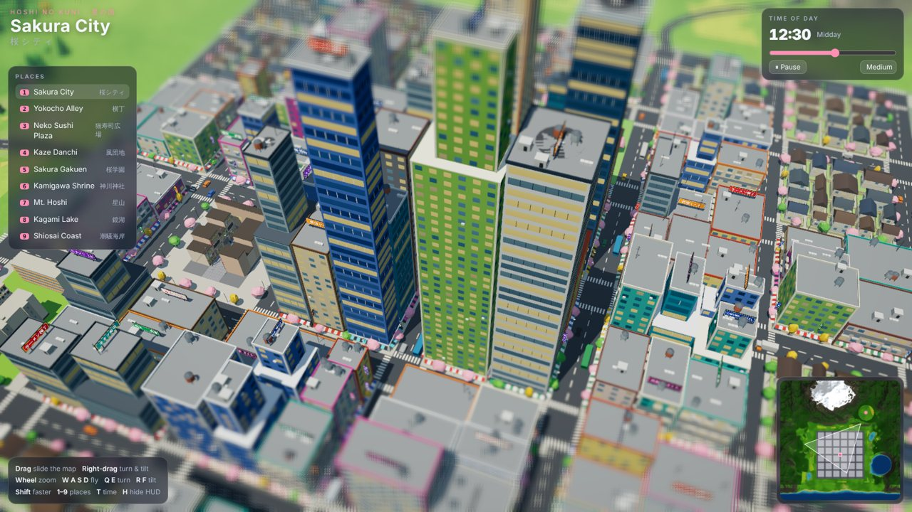
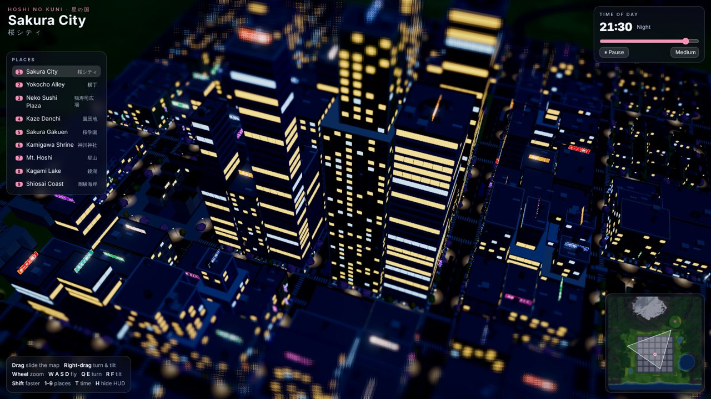
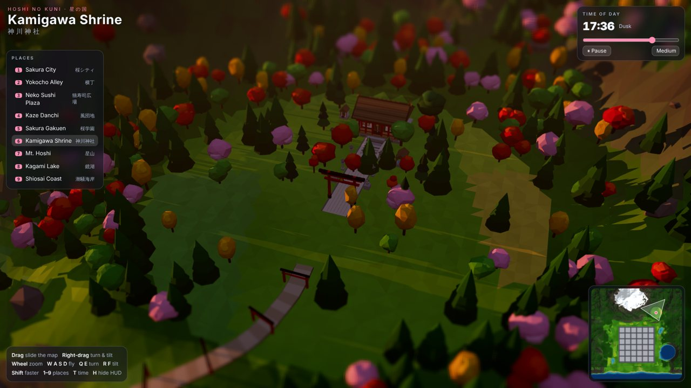
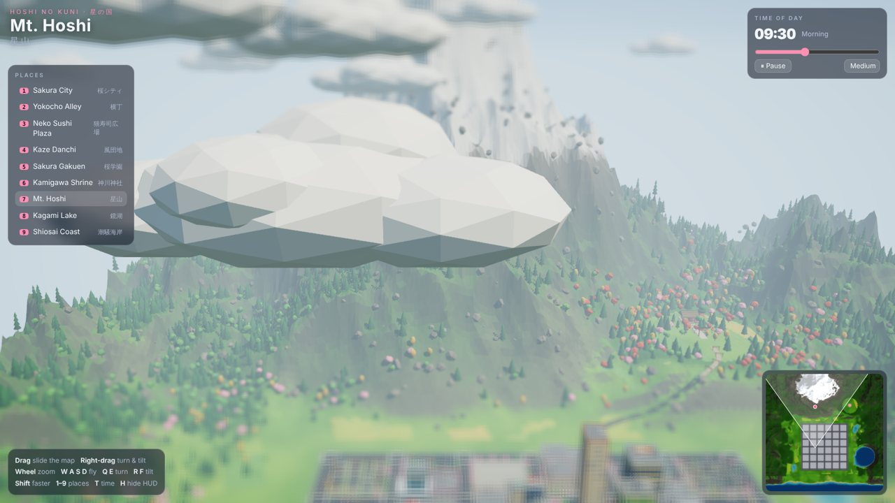

# Hoshi no Kuni 星の国 — a low-poly Japan seen from a drone

A 3D open world in the browser (three.js + TypeScript + Vite). You fly a drone over a miniature Japan: a big city,
a shrine in the forest, a snowy volcano, a lake, farm fields, a village and the sea. Day turns to night, the lights of
the city glow, cars drive on the left. The camera has a tilt-shift look, so the whole world feels like a model.

This is the **world only**. Characters come next.

```bash
npm install
npm run dev        # http://localhost:5173
npm run build      # production build in dist/
npm test           # tests of the world layout
```

## Controls

| | |
|---|---|
| Drag | slide the map |
| Right-drag (or Shift-drag) | turn and tilt |
| Wheel / `+` `-` | zoom |
| `W A S D` / arrows | fly (`Shift` = faster) |
| `Q` `E` | turn · `R` `F` tilt |
| `1`–`9` | fly to a place (also the list on the left) |
| Click the minimap | fly there |
| `T` | pause / play the clock · `H` hide the HUD |

Two-finger pinch zooms on touch screens. The picture quality (Low / Medium / High) is in the clock panel: Low skips the
post effects, High adds ambient occlusion.

URL options: `?t=21.5` (hour), `?view=shrine`, `?q=high`, `?pause=1`, `?hud=0`, `?yaw=30&pitch=45&dist=200`.

## The world (1 km × 1 km)

| Place | What is there |
|---|---|
| **Sakura City** 桜シティ | 6 × 6 blocks, ~400 m wide: glass towers up to 150 m, shophouses with awnings and balconies, neon signs and billboards, roof gear, street lamps, cherry trees, zebra crossings, ~100 vehicles |
| **Yokocho Alley** 横丁 | the back alley (`japanalley.glb`) |
| **Neko Sushi Plaza** 猫寿司広場 | the cat's sushi cart in a cherry-tree park (`catstall.glb`) |
| **Kaze Danchi** 風団地 | the housing complex (`danchi.glb`) |
| **Sakura Gakuen** 桜学園 | the school (`japanschool.glb`) |
| **Kamigawa Shrine** 神川神社 | the shrine on a mountain terrace (`japanshrine.glb`), reached by a mountain road with guard rails and red torii gates |
| **Mt. Hoshi** 星山 | the volcano with a snow cap, mountain ranges on three sides, rocks |
| **Kagami Lake** 鏡湖 | a lake whose colour deepens with the depth |
| **Shiosai Coast** 潮騒海岸 | beach, sea and a promenade |
| **Hanano Fields** 花野 | a patchwork of farm fields, a forest of cedar, pine, maple, ginkgo and cherry trees (~4,500 instanced trees) and a village at the end of the west road |

The five landmarks come from the GLB files in `assets/core/places/`. They are merged by colour at start-up, so hundreds
of parts become a few draw calls.

## How it looks good (and runs)

- Flat-shaded, vertex-coloured geometry everywhere; boxes carry a baked "ambient occlusion" gradient.
- Sun with soft shadows that follow the drone, hemisphere light, moon, fog and a gradient sky with a sun disc and stars.
  A clock drives the colours of the sky, the light, the fog and the exposure (`src/world/daylight.ts`).
- Lit windows, neon signs, lamp heads and landmark lights switch on at night and bloom.
- Post effects: bloom, tilt-shift blur, colour grading, SMAA, optional ambient occlusion (`src/fx/post.ts`).
- Districts are merged per block (about 400 meshes, ~0.9 M triangles); trees, cars, lamps and clouds are instanced.
- Buildings and roofs are registered in a coarse skyline map so the drone camera never flies through a building.

## Code

```
src/main.ts            start-up, loop, quality, the window.__game test hook
src/camera/drone.ts    the drone camera and its controls
src/world/config.ts    the shape of the world: heights, roads, places, forest density
src/world/terrain.ts   the terrain mesh and its colours (grass, fields, forest, rock, snow, sand)
src/world/city.ts      roads, blocks, buildings, signs, lamps, parks, the village
src/world/forest.ts    trees and rocks    src/world/roads.ts   roads and the mountain approach
src/world/landmarks.ts GLB loading and merging    src/world/traffic.ts   vehicles
src/world/sky.ts       sky dome and clouds    src/world/daylight.ts   the clock    src/world/water.ts
src/ui/hud.ts          the HUD and the minimap    src/fx/post.ts   post effects
tests/world.test.ts    determinism, roads, flat city, places
e2e/shots.mjs          screenshots with Playwright (npm run dev -- --port 5300 first)
```

## Previews

| | |
|---|---|
|  |  |
|  |  |

---

## Assets

Low-poly 3D assets for the web game, made in Poly Studio and exported as GLB (glTF 2.0, validated with gltf-validator, 0 errors).

Assets are split by status (`core` is used by the game, `experimental` is for tests and style studies) and by kind (`characters` and `places`).

## Core

### Characters (`assets/core/characters/`)

Same chunky base style, skinned to a 22-joint skeleton.

| File | Asset |
|---|---|
| `gamenurse.glb` | Game Nurse |
| `firefighter.glb` | Firefighter |
| `seifuku.glb` | Game Schoolgirl (Japanese sailor uniform, twin tails) |

### Places (`assets/core/places/`)

Static scenes, no skeleton.

| File | Asset |
|---|---|
| `japanhouse.glb` | Japanese House (minka with shoji doors, veranda and garden) |
| `japanschool.glb` | Japanese School (school building, clock tower, gym, schoolyard, cherry trees) |
| `japanshrine.glb` | Japanese Shrine (torii, lanterns, lion-dogs, fountain, main hall) |
| `japanalley.glb` | Japanese Alley (back alley of plaster shophouses, after a low-poly reference) |
| `catstall.glb` | Cat Sushi Stall (yatai cart with a cat chef on a cobblestone plaza) |
| `danchi.glb` | Japanese Housing Complex (two apartment blocks with balconies, courtyard, far block) |

## Experimental

### Characters (`assets/experimental/characters/`)

| File | Asset |
|---|---|
| `casual.glb` | Casual Girl — **style reference for all future characters** (stays experimental, not shipped in the game) |
| `school.glb` | School Girl |
| `nurse.glb` | Nurse (first version, older style) |
| `ribbon.glb` | Red Ribbon Girl |
| `anime.glb` | Pink Anime Girl |

### Places (`assets/experimental/places/`)

| File | Asset |
|---|---|
| `japanshops.glb` | Japanese Shopping Street (eight shops, arch, poles, vending machines) |
| `island.glb` | Forest Island diorama |

No animations yet; the character rigs are ready for them.
