# Hoshi no Kuni 星の国 — a dense little Japanese hillside town under a big mountain

A 3D world in the browser (three.js + TypeScript + Vite), seen from a drone. It is small on purpose and packed with
detail, like a real Japanese neighbourhood built up a hillside: three terraces held by concrete retaining walls (with
caps, drains and fences), ramp streets that climb from one terrace to the next between walls and railings, stair
alleys up the walls, house rows on raised strips with little steps down to the lane, and rice paddies stepping down
the slope below. In the streets: buildings shoulder to shoulder and every one different (shops with box,
striped and curved awnings, round signs, noren and banners; a café with outside stairs; tiled walls; apartment blocks
with open corridors and laundry; offices with roof billboards), a konbini and a supermarket with car parks, a main
street with pavements, tactile strips, curbs and gutters, a signalled crossing with traffic lights, back lanes with red
paint and 止まれ, utility poles with transformers and wires, double red lamps, green-white guard pipes, vending
machines, hydrants, cones, convex mirrors, road signs and moving traffic. Below the town the cross street runs on to the Hoshinomachi IC, crossing on a short bridge over the road that links the
west and east lanes through a concrete underpass. At the IC: a toll plaza with ETC and
general booths under green canopies, and ramps up to an elevated four-lane expressway on piers, with sound walls, a
median, lights, green sign gantries and fast traffic, cut through the hills at both ends. Around the town: stepped rice paddies, a koi pond, wooded hills on both sides, and
a forest-covered mountain with a shrine reached by a stone path and red torii gates. No lot is left bare: every free patch becomes a coin car park, a yatai food stall, a pocket park with swings, bicycle
parking, a vending machine corner with a green phone box, a little roadside shrine, a vegetable garden or a nook of
pots and bikes. Day turns to night: windows, shop
signs and lamps light up.

This is the **world only**. Characters come next. (The earlier big-city version is kept in the git history: commit
`fb057cc`, tag `city-world`.)

```bash
npm install
npm run dev        # http://localhost:5173
npm run build      # production build in dist/
npm test           # tests of the world layout
node scripts/build-artifact.mjs   # one single HTML file with the shrine model inside (dist-artifact/index.html)
```

## Controls

| | |
|---|---|
| Drag | slide the map |
| Right-drag (or Shift-drag) | turn and tilt |
| Wheel / `+` `-` | zoom (down to 10 m from the ground) |
| `W A S D` / arrows | fly (`Shift` = faster) |
| `Q` `E` | turn · `R` `F` tilt |
| `1`–`7` | fly to a place (also the list on the left) |
| Click the minimap | fly there |
| `T` | pause / play the clock · `H` hide the HUD |

URL options: `?t=21.5` (hour), `?view=corner`, `?q=high`, `?pause=1`, `?hud=0`, `?yaw=30&pitch=45&dist=200`.
Low / Medium / High quality is in the clock panel; a slow machine is stepped down automatically.

## The map (300 × 300 m to fly over, the ground goes on behind the mountain)

| Place | What is there |
|---|---|
| **Ramen Corner** ラーメン角 | the ramen shop with a teal awning, noren and red banners, a tall stack on its side, two vending machines, a 30 km/h sign, a stop sign and 止まれ painted on the lane, a convex mirror, guardrails, a mini truck, bicycles, a red street lamp |
| **Hoshi Village** 星の村 | 35 houses and shops on both sides of the main street and two lanes, the bus stop, utility poles with 5 wires each and drops to every house, parked cars, three cars driving on the left, groves |
| **Main Street** 本通り | zebra crossing, yellow edge lines, dashed centre line |
| **Rice Paddies** 田んぼ | 70 plots, some flooded, with banks, an irrigation ditch, scarecrows, straw bales, drying poles and a shed |
| **Koi Pond** 鯉の池 | a pond with rocks, lily pads and a wooden pier |
| **Kamigawa Shrine** 神川神社 | the shrine (`assets/core/places/japanshrine.glb`) on a terrace, reached by the lane north, which turns into a stone path with torii gates and jizo statues |
| **Mt. Hoshi** 星山 | a 215 m mountain behind the village: ~6,000 cedar, pine, maple, ginkgo and jacaranda trees on its slopes, rocks, scree and a snow cap |

## How it is made

- Everything in the village is generated from boxes, cones and blobs into flat-shaded, vertex-coloured meshes
  (`src/util/builder.ts`), a few big meshes per 50 m chunk. Houses are built in their own frame and placed with a turn
  (`src/world/village/house.ts`), so each is one parametric recipe: floors, wall colours, roof (gable or hip, with tile
  rows, fascia and gutter), pent eaves, shutters with slats, balcony, air conditioner with hose, antenna, a door with a
  step and porch light, or a shop front with an awning.
- Signs, banners, the speed limit, vending machine fronts and the words on the road are drawn once into one texture
  (`src/world/signs.ts`).
- Sun with soft shadows that follow the drone, hemisphere light, moon, fog, a sky with a sun disc and stars; a clock
  drives it all (`src/world/daylight.ts`). Lit windows, signs, lamps and lanterns glow at night.
- Bloom, a tilt-shift blur that makes the village look like a model, colour grading, SMAA and optional ambient occlusion
  (`src/fx/post.ts`).
- Trees, rocks, cars and clouds are instanced. Roofs are registered in a coarse skyline map so the camera never flies
  through a house.

```
src/main.ts              start-up, loop, quality, the window.__game test hook
src/camera/drone.ts      the drone camera and its controls
src/world/config.ts      the shape of the world: heights, roads, places, forest density
src/world/terrain.ts     the terrain mesh and its colours        src/world/water.ts   the pond
src/world/village/       frame.ts (walls, windows, signs)  house.ts  props.ts  index.ts (the layout)
src/world/roads.ts       road ribbons, markings, the stone path and torii
src/world/forest.ts      trees and rocks       src/world/vehicles.ts + traffic.ts   cars
src/world/landmarks.ts   the shrine model       src/world/sky.ts   src/world/daylight.ts
src/ui/hud.ts            the HUD and the minimap
tests/world.test.ts      determinism, flat village, roads, places
e2e/shots.mjs            screenshots with Playwright (npm run dev -- --port 5300 first)
```

## Previews

| | |
|---|---|
| 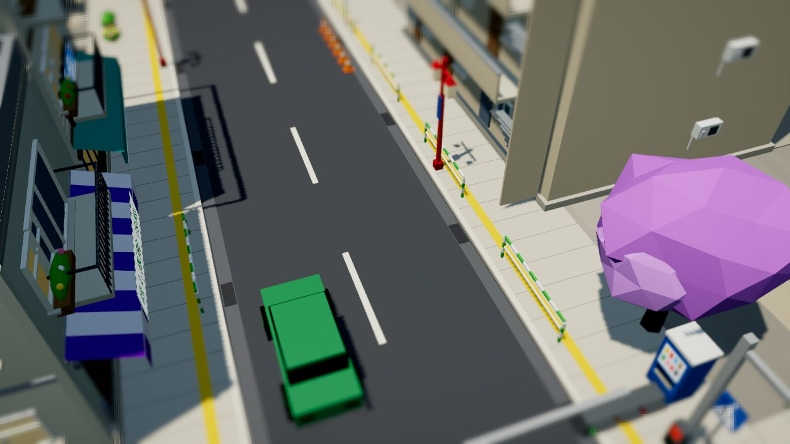 | 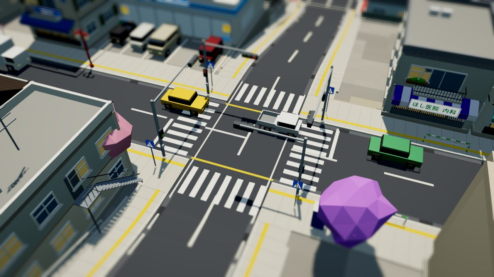 |
| 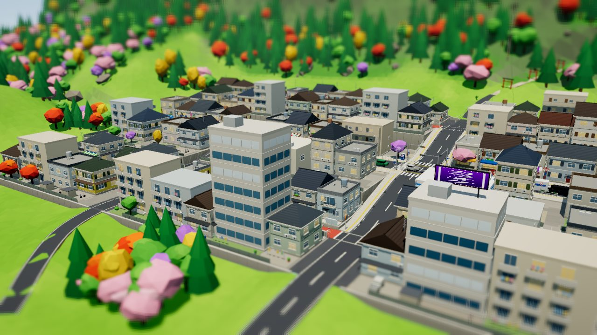 | 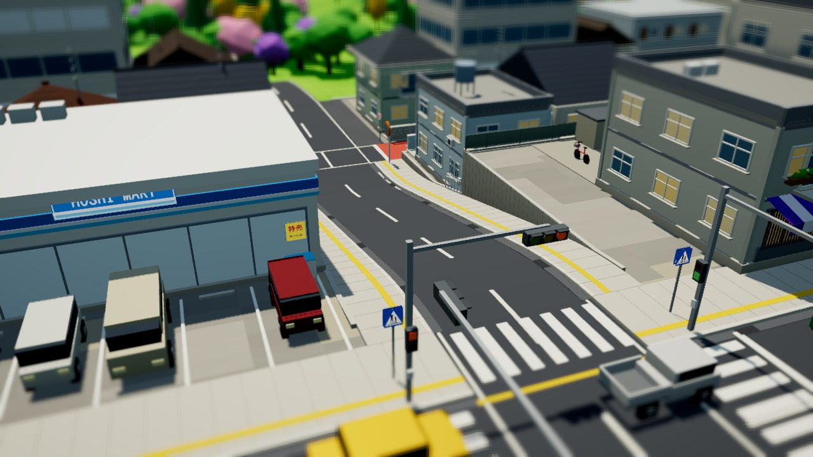 |
| 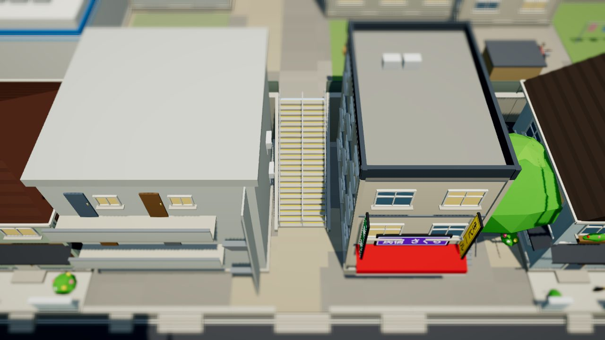 | 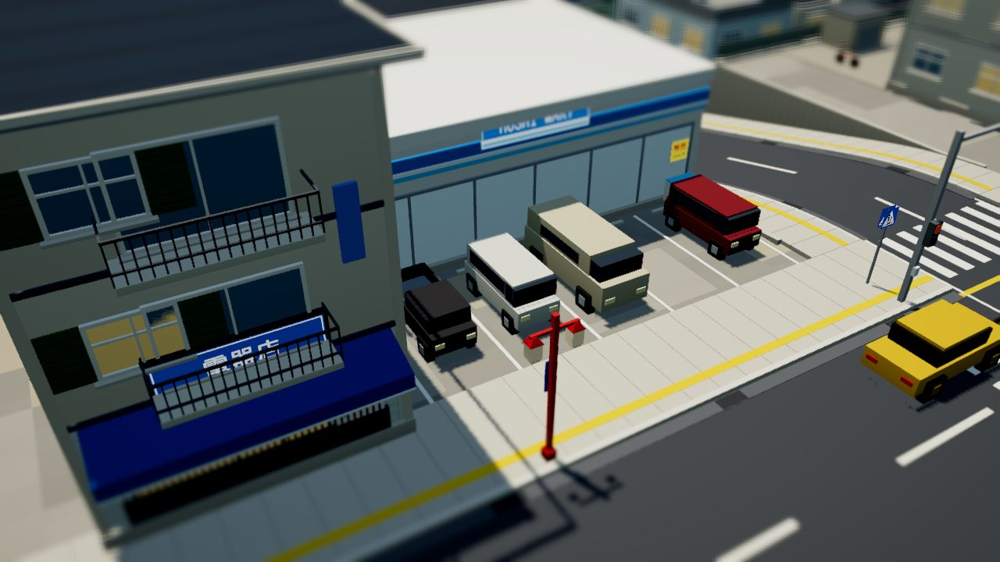 |
| 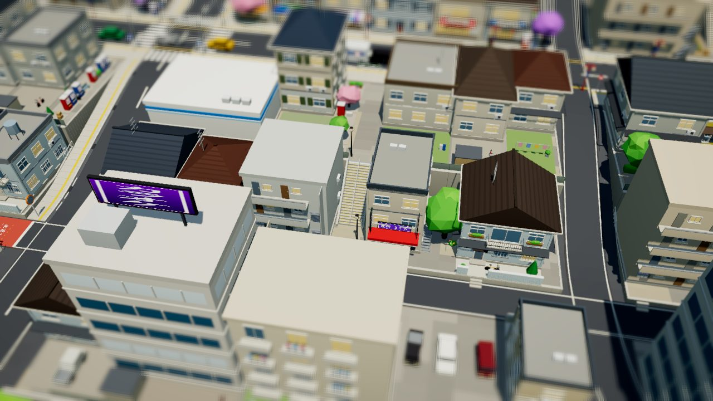 | 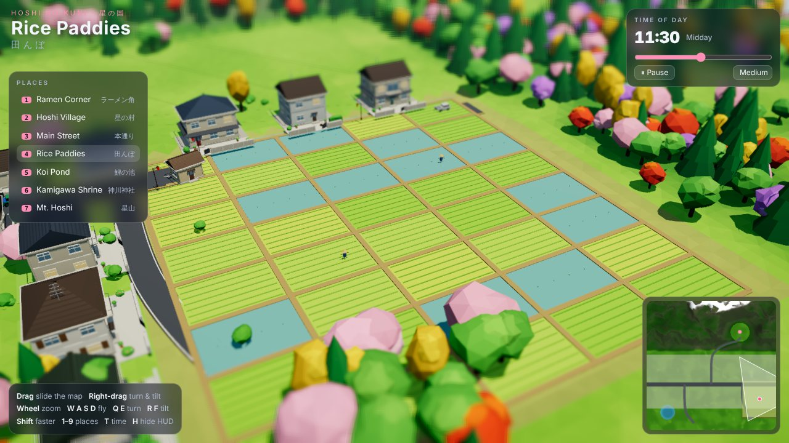 |
| 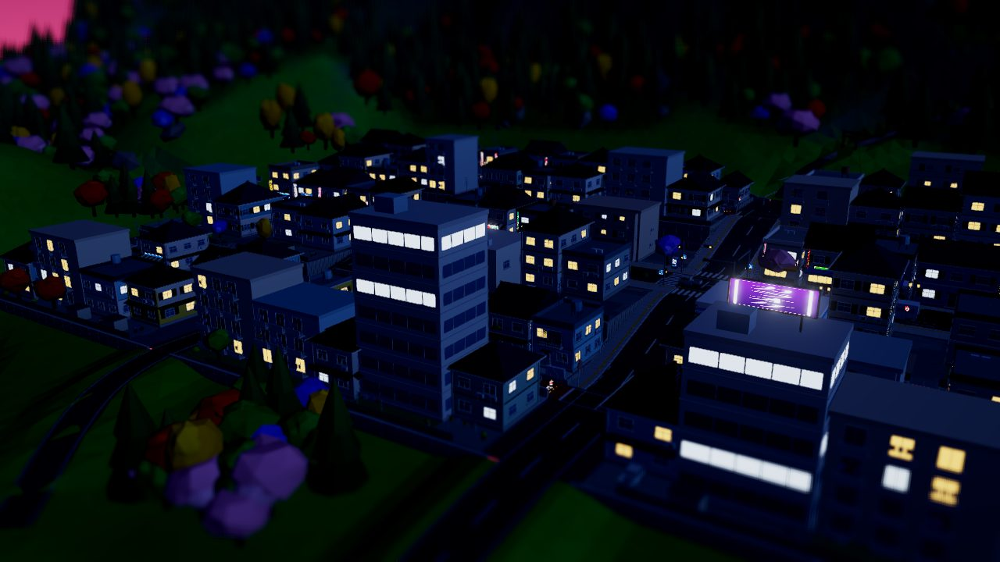 | 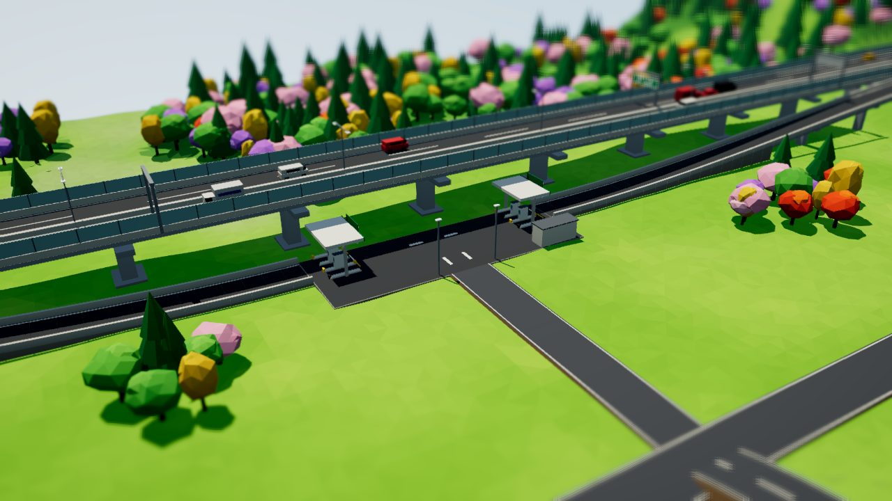 |
| 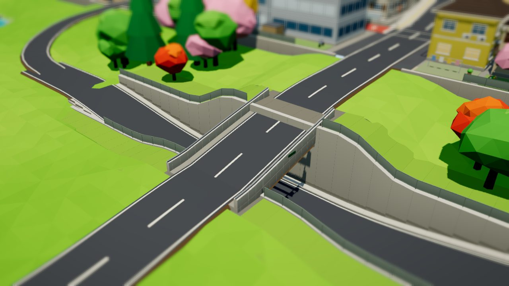 | |

---

## Assets

Low-poly 3D assets for the web game, made in Poly Studio and exported as GLB (glTF 2.0, validated with gltf-validator, 0 errors).

Assets are split by status (`core` is used by the game, `experimental` is for tests and style studies) and by kind (`characters` and `places`).

## Core

### Characters (`assets/core/characters/`)

Same chunky base style, skinned to a 22-joint skeleton.

| File | Asset |
|---|---|
| `gamenurse.glb` | Game Nurse |
| `firefighter.glb` | Firefighter |
| `seifuku.glb` | Game Schoolgirl (Japanese sailor uniform, twin tails) |

### Places (`assets/core/places/`)

Static scenes, no skeleton.

| File | Asset |
|---|---|
| `japanhouse.glb` | Japanese House (minka with shoji doors, veranda and garden) |
| `japanschool.glb` | Japanese School (school building, clock tower, gym, schoolyard, cherry trees) |
| `japanshrine.glb` | Japanese Shrine (torii, lanterns, lion-dogs, fountain, main hall) |
| `japanalley.glb` | Japanese Alley (back alley of plaster shophouses, after a low-poly reference) |
| `catstall.glb` | Cat Sushi Stall (yatai cart with a cat chef on a cobblestone plaza) |
| `danchi.glb` | Japanese Housing Complex (two apartment blocks with balconies, courtyard, far block) |

## Experimental

### Characters (`assets/experimental/characters/`)

| File | Asset |
|---|---|
| `casual.glb` | Casual Girl — **style reference for all future characters** (stays experimental, not shipped in the game) |
| `school.glb` | School Girl |
| `nurse.glb` | Nurse (first version, older style) |
| `ribbon.glb` | Red Ribbon Girl |
| `anime.glb` | Pink Anime Girl |

### Places (`assets/experimental/places/`)

| File | Asset |
|---|---|
| `japanshops.glb` | Japanese Shopping Street (eight shops, arch, poles, vending machines) |
| `island.glb` | Forest Island diorama |

No animations yet; the character rigs are ready for them.
